# Flutter Food Discovery — StreetBite

Flutter app for browsing street-food meals, saving favorites, and placing an order. Meals come from TheMealDB. Sign-in, the user profile, and orders use Firebase. The bottom bar has Home, Favorites, Cart, and Settings. Settings asks for a fingerprint before it opens, and it keeps the chosen language and theme for the next launch.

---

## Requirements

- [Flutter SDK](https://docs.flutter.dev/get-started/install) (Dart `^3.12.2`)
- Git
- A device or emulator for `flutter run` (fingerprint and the gallery need a device that supports them)
- A Firebase project with Email/Password auth and Cloud Firestore, and `android/app/google-services.json` in place

Check your setup:

```bash
flutter doctor
```

---

## Clone the project

```bash
git clone https://github.com/AhmedSobhyHamed/FlutterFoodDiscovery_StreetBite.git
cd FlutterFoodDiscovery_StreetBite
```

```bash
flutter create . --project-name flutterfooddiscovery_streetbite --platforms=web,android,linux
```
or
```bash
podman exec -it flutter_dev sh -c "cd apps/FlutterFoodDiscovery_StreetBite; flutter create . --project-name flutterfooddiscovery_streetbite --platforms=web,android,linux"
```

---

## Install packages

From the project root:

```bash
flutter pub get
```

```bash
flutter pub add cupertino_icons:^1.0.8
flutter pub add flutter_localization:^0.4.1
flutter pub add firebase_core:^5.0.0
flutter pub add flutter_svg:^2.3.0
flutter pub add get_it:^9.3.0
flutter pub add equatable:^3.0.0
flutter pub add shared_preferences:^2.5.6
flutter pub add flutter_bloc:^9.1.1
flutter pub add dartz:^0.10.1
flutter pub add dio:^5.11.1
flutter pub add firebase_auth:^7.0.0
flutter pub add cloud_firestore:^7.0.0
flutter pub add image_picker:^1.2.4
flutter pub add local_auth:^3.0.2
```
or
```bash
podman exec -it flutter_dev sh -c "cd apps/FlutterFoodDiscovery_StreetBite; flutter pub add cupertino_icons:^1.0.8"
podman exec -it flutter_dev sh -c "cd apps/FlutterFoodDiscovery_StreetBite; flutter pub add flutter_localization:^0.4.1"
podman exec -it flutter_dev sh -c "cd apps/FlutterFoodDiscovery_StreetBite; flutter pub add firebase_core:^5.0.0"
podman exec -it flutter_dev sh -c "cd apps/FlutterFoodDiscovery_StreetBite; flutter pub add flutter_svg:^2.3.0"
podman exec -it flutter_dev sh -c "cd apps/FlutterFoodDiscovery_StreetBite; flutter pub add get_it:^9.3.0"
podman exec -it flutter_dev sh -c "cd apps/FlutterFoodDiscovery_StreetBite; flutter pub add equatable:^3.0.0"
podman exec -it flutter_dev sh -c "cd apps/FlutterFoodDiscovery_StreetBite; flutter pub add shared_preferences:^2.5.6"
podman exec -it flutter_dev sh -c "cd apps/FlutterFoodDiscovery_StreetBite; flutter pub add flutter_bloc:^9.1.1"
podman exec -it flutter_dev sh -c "cd apps/FlutterFoodDiscovery_StreetBite; flutter pub add dartz:^0.10.1"
podman exec -it flutter_dev sh -c "cd apps/FlutterFoodDiscovery_StreetBite; flutter pub add dio:^5.11.1"
podman exec -it flutter_dev sh -c "cd apps/FlutterFoodDiscovery_StreetBite; flutter pub add firebase_auth:^7.0.0"
podman exec -it flutter_dev sh -c "cd apps/FlutterFoodDiscovery_StreetBite; flutter pub add cloud_firestore:^7.0.0"
podman exec -it flutter_dev sh -c "cd apps/FlutterFoodDiscovery_StreetBite; flutter pub add image_picker:^1.2.4"
podman exec -it flutter_dev sh -c "cd apps/FlutterFoodDiscovery_StreetBite; flutter pub add local_auth:^3.0.2"
```

This installs:

| Package | Role |
|---|---|
| `firebase_core` | Starts Firebase before the first screen |
| `firebase_auth` | Email and password sign-in, and the saved session |
| `cloud_firestore` | User profile and placed orders |
| `dio` | TheMealDB requests |
| `shared_preferences` | Cached meals, cart, favorites, and the saved theme |
| `flutter_bloc` | Screen state for splash, auth, meals, cart, favorites, and settings |
| `get_it` | Registers data sources, repositories, use cases, and cubits |
| `dartz` | `Either` results from use cases |
| `equatable` | Value equality for states and entities |
| `flutter_localization` | English and Arabic strings, saved for the next launch |
| `local_auth` | Fingerprint prompt before Settings |
| `image_picker` | One gallery photo for the profile |
| `flutter_svg` | Vector assets |
| `cupertino_icons` | Icons |

Android biometric access is `android.permission.USE_BIOMETRIC` in `android/app/src/main/AndroidManifest.xml`. `MainActivity` extends `FlutterFragmentActivity` so the fingerprint dialog can open. Copy `google-services.json` into `android/app/` from the Firebase console. Firestore needs rules that let a signed-in user read and write only `users/{their uid}`, and create and read only their own `orders` documents.

---

## Run the project

```bash
flutter devices
flutter run
```

Pick a device if more than one is connected:

```bash
flutter run -d emulator-5554
flutter run -d linux
flutter run -d chrome
```

Home, cart, and favorites work where the device can store data and reach TheMealDB. Sign-in, profile, orders, the gallery photo, and fingerprint are meant for Android with Firebase and an enrolled fingerprint.

---

## Build a release

`INTERNET` is declared in `android/app/src/main/AndroidManifest.xml`, which is the manifest the release build uses. Release shrinking is off so the release APK starts the same way as `flutter run`.

```bash
flutter build apk --release
```

or

```bash
podman exec -it flutter_dev sh -c "cd apps/FlutterFoodDiscovery_StreetBite; flutter build apk --release"
```

The file is `build/app/outputs/flutter-apk/app-release.apk`. Install it on a connected phone:

```bash
adb install -r build/app/outputs/flutter-apk/app-release.apk
```

Upload that APK to Firebase App Distribution. `xxxx` is the Android app id from Project settings → Your apps.

```bash
firebase appdistribution:distribute build/app/outputs/flutter-apk/app-release.apk --app xxxx --groups testers --release-notes "StreetBite release"
```

The uploaded release is on Firebase App Distribution: [StreetBite 1.0.0](https://appdistribution.firebase.google.com/testerapps/1:419627227242:android:d2bffa41321ae298aad213/releases/7bip9rmp99pl0?utm_source=firebase-console). Sign in with the tester Google account, then install from that page.

---

## Tech stack

| Layer | Technology |
|---|---|
| UI | Flutter, Material 3 |
| Language | Dart 3.12+ |
| State | `flutter_bloc` cubits, `get_it` |
| Meals | TheMealDB through `dio`, cached with `shared_preferences` |
| Auth | `firebase_auth` — email and password, session restored on launch |
| Profile and orders | `cloud_firestore` |
| Settings gate | `local_auth` — fingerprint before Settings |
| Photo | `image_picker` — one gallery image |
| Language and theme | `flutter_localization` (English, Arabic) and light or dark `ThemeData`, both kept for the next launch |
| Local lists | Cart and favorites in `shared_preferences` |

---

## Project structure

```
lib/
├── main.dart                                      # Firebase, dependencies, theme, locale
├── core/
│   ├── data_source.dart/
│   │   ├── app_api_endpoints.dart                 # TheMealDB base URL
│   │   ├── data_source_interface.dart
│   │   ├── local_data_source.dart                 # SharedPreferences
│   │   └── remote_data_source.dart                # Dio
│   ├── di/injection.dart                          # GetIt setup
│   ├── services/
│   │   ├── fingerprint_service.dart               # authenticate
│   │   ├── fingerprint_via_local_auth.dart
│   │   └── image_service.dart                     # pickOneFromGallery
│   ├── themes/app_theme.dart                      # Light, dark, and the saved choice
│   └── l10n/app_settings.dart                     # Apply language and theme
└── features/
    ├── splah/                                     # Splash, then restore the session
    ├── auth/                                      # Login, signup, verify email, sign out
    ├── main_controller/                           # Bottom bar: Home, Favorites, Cart, Settings
    ├── meals/                                     # Categories, offers, meals, details
    ├── fav/                                       # Local favorites
    ├── cart/                                      # Local cart, quantity 1–99
    ├── order/                                     # Write the cart to Firestore, then clear it
    └── settings/                                  # Profile, language, theme
```

### How the layers fit

- **Splash** — runs first, then loads the current Firebase user. A saved session opens Home. Otherwise the app opens Login.
- **Auth** — email and password. A successful login or signup writes `users/{uid}` with id, name, and email. Sign-out returns to Login.
- **Home** — categories, hot offers, and a meal grid from TheMealDB. The first category is selected and that choice is saved. Pull to refresh clears the meal cache and loads again. A meal opens its details page. The green add button puts the meal in the cart.
- **Favorites** — meals saved on the device. The add button on a row puts that meal in the cart.
- **Cart** — local lines with quantity from 1 to 99. The list scrolls above a fixed Order now button. A successful order shows "Order placed" and leaves the cart empty.
- **Order** — writes `orders` in Firestore with the signed-in user id and each meal id and quantity, then clears the cart.
- **Settings** — fingerprint first, and only for a signed-in user. The page edits name, email, and one gallery photo, sends email verification, and signs out. Language is English or Arabic. Theme is light or dark. Both apply immediately and stay for the next launch.

---

## Useful commands

```bash
flutter pub get              # install dependencies
flutter run                  # run on a connected device
flutter build apk --release  # Android release APK
flutter test                 # run tests
flutter analyze              # static analysis
```

---

## Screenshots

### Login

Email and password, then Continue. Invalid email and a short password are shown under the fields. Sign up opens the create-account sheet.

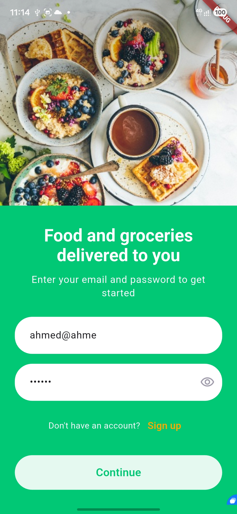
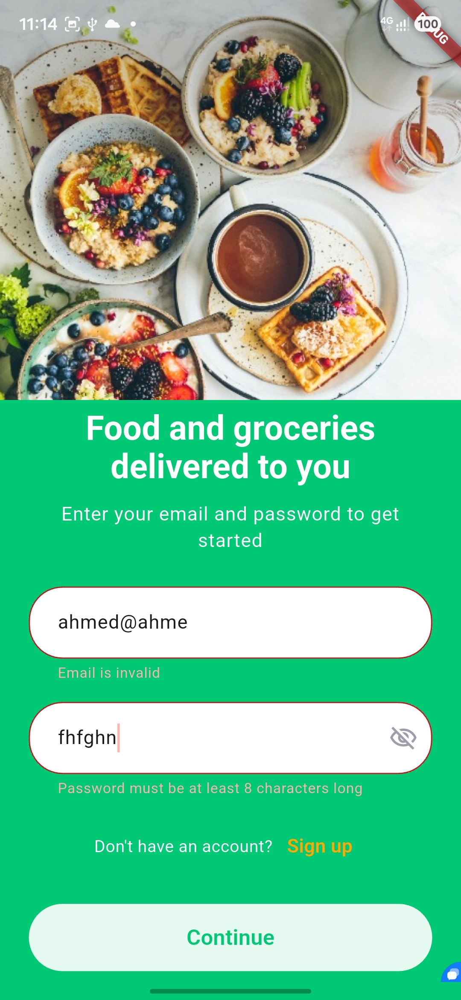
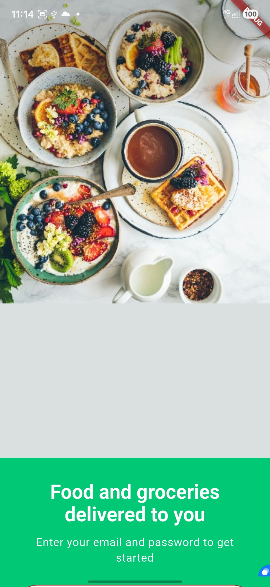

### Sign up

Name, email, password, and confirm password. Login switches back to the sign-in form.

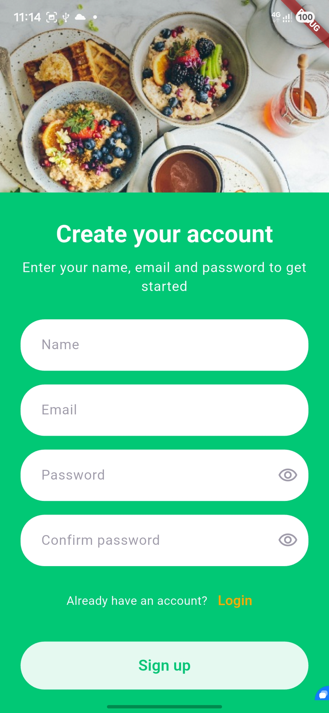
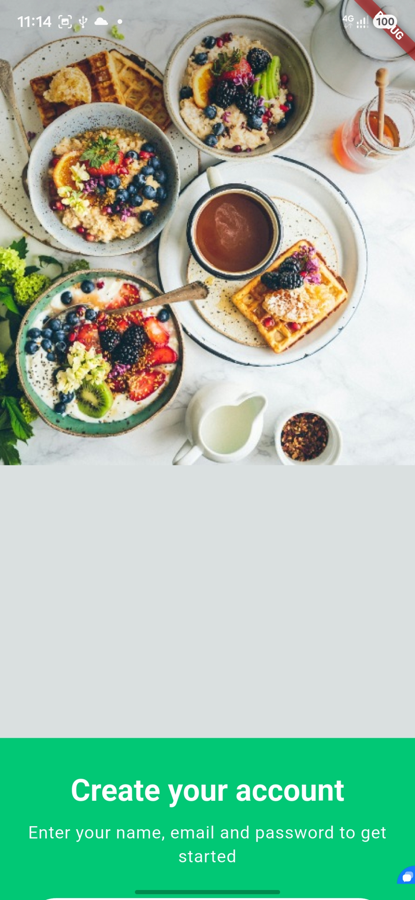

### Home

Categories, hot offers, and the meal grid. Pull down to refresh.

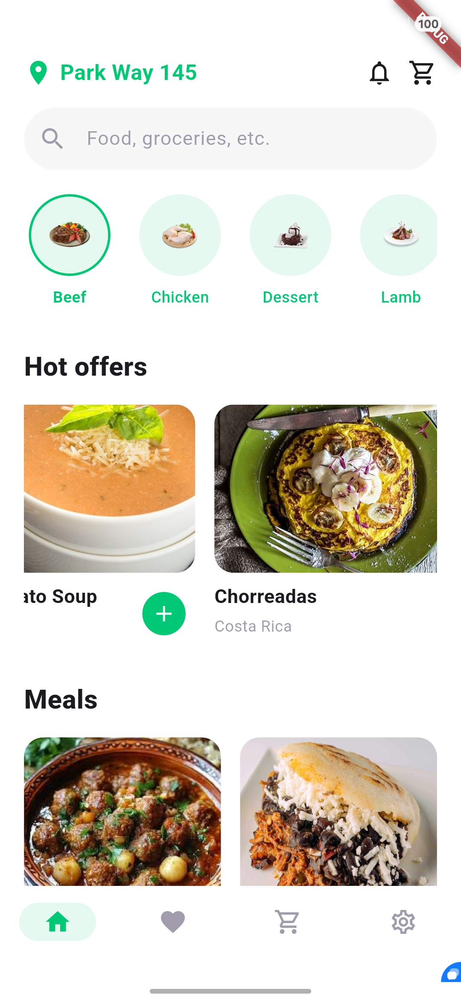
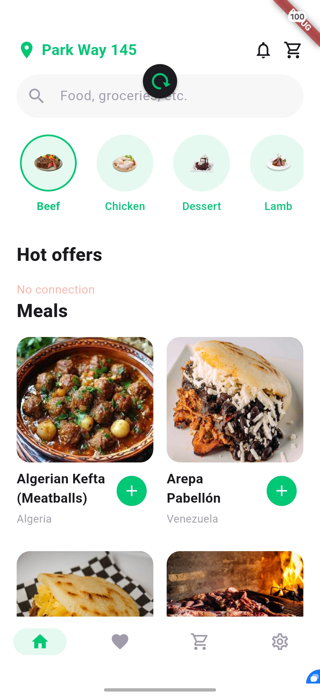

### Favorites

Saved meals. The green button adds the meal to the cart.

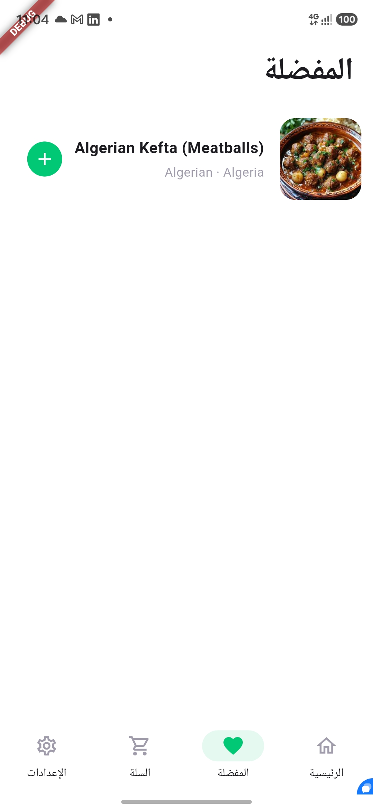

### Cart

Quantity from 1 to 99, delete, and Order now fixed at the bottom. After a successful order the cart is empty and the app shows that the order was sent.

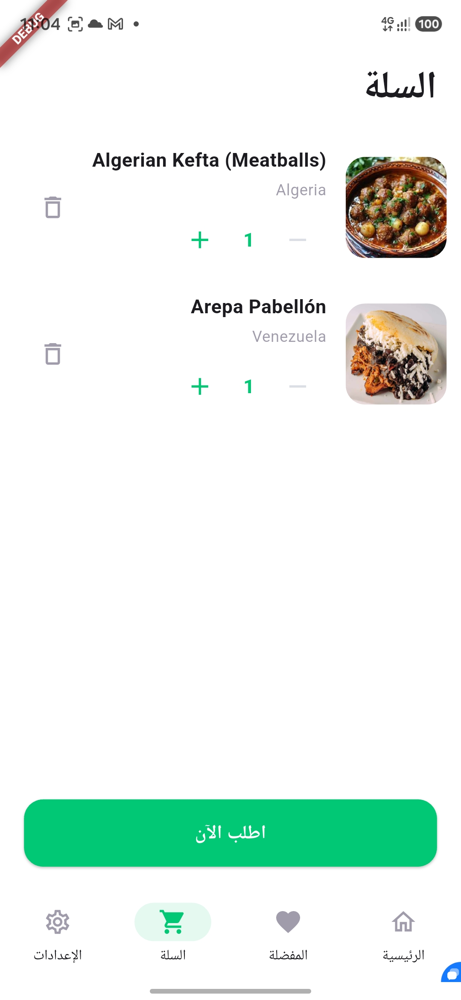


### Settings

Opened from the bottom bar after a fingerprint. Profile photo, name, and email, then language and theme. The gallery picker supplies one photo. Dark theme and English are saved for the next launch.

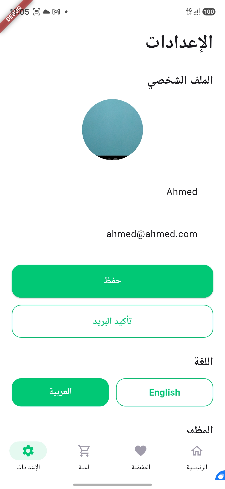

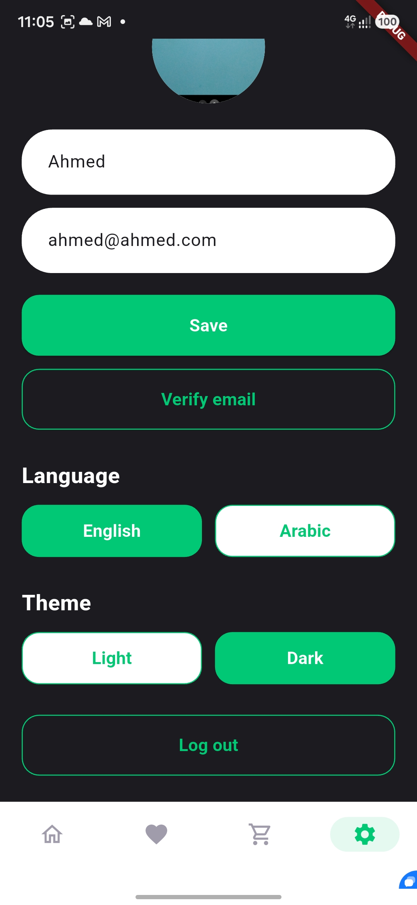
